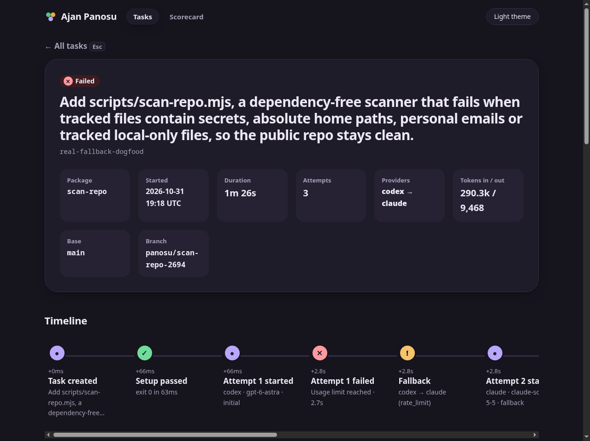

# Ajan Panosu (agent-board)

A small, local TypeScript tool that lets one orchestrator agent hand coding tasks to other agents, verifies the result, has a second model review it, and records everything as a privacy-safe event log you can inspect.

It runs on your own subscriptions: only the official `claude` and `codex` CLIs are started as child processes. No token extraction, no unofficial endpoints, no telemetry.

## How it works

```
orchestrator (Claude Opus)           writes a task package, reads a short verdict
        │  panosu delegate task.md
        ▼
 git worktree per task ── attempt loop ── Codex first, Claude Sonnet as fallback
        │                    │
        │                    └─ your verify command runs after every attempt;
        │                       failures are fed back, up to max_retries
        ▼
 cross-review by the other provider (structured JSON)
        ▼
 event log (JSONL, outside the repo)  →  read-only API  →  board
```

- **Delegate:** a task package (Markdown + YAML frontmatter) states the goal, the files to read, constraints, acceptance criteria and one `verify` command.
- **Verify and retry:** the verify command runs in the worktree after each attempt; its output tail goes back to the same provider.
- **Fallback:** if Codex reports its usage limit, the next provider takes over (observed live; see `docs/contracts/provider-adapter.md`).
- **Cross-review:** the other provider reviews the diff (embedded in the prompt, no tools) and returns `approve` / `changes_requested`.
- **Observe:** the log is the single source of truth; the API and scorecard are derived from it.

## Status

Stages 1-4 of 6 are done: core, the `panosu` CLI (`delegate`, `list`, `eval`), real Codex and Claude adapters, the read-only API with scorecard math, and the board (React, airy design). Stage 5 (the tool delegating its own work) is under way. Details: `docs/architecture.md`, `docs/plans/`.




## Quick start

Requirements: Node 22+ (Node 24+ to run the golden evals), pnpm.

```
pnpm install
pnpm lint && pnpm typecheck && pnpm test && pnpm build
node scripts/scan-repo.mjs            # secrets / personal data scan

# try the whole flow without any model call
node packages/cli/dist/bin.js delegate task.md --scenario success --events-dir /tmp/panosu-events
node packages/cli/dist/bin.js list --events-dir /tmp/panosu-events

# the board on the fixture logs, no model calls
pnpm demo

# the read-only API over your own logs
pnpm serve -- --events-dir ~/.ajan-panosu/events
```

Real runs (`delegate` without `--scenario`) spend subscription quota. Write task packages as described in `docs/orchestrator-guide.md`.

## Layout

| Path | What |
|---|---|
| `packages/core` | zod schemas, adapter interface, `runTask` (retry, fallback, verify, review), scorecard math. No I/O. |
| `packages/cli` | `panosu` command, worktrees, verify runner, event writer, Codex and Claude adapters, `eval`. |
| `packages/server` | read-only Hono API (`panosu-serve`). |
| `packages/web` | React + Vite board (task list, task detail with diff, scorecard). |
| `docs/` | PRD, architecture, contracts, ADRs, plans, design prototypes. |
| `fixtures/` | example event logs and sanitized real CLI samples. |
| `evals/` | golden tasks with hidden checks for comparing models. |

## Safety

- One git worktree per task; the CLI never merges anything.
- Event logs live in `~/.ajan-panosu/events`, the home directory is replaced by `~` before writing.
- The board and API never read `~/.claude` or `~/.codex`.
- `scripts/scan-repo.mjs` runs in CI to keep secrets and personal paths out of the repository.

## License

Not chosen yet.
