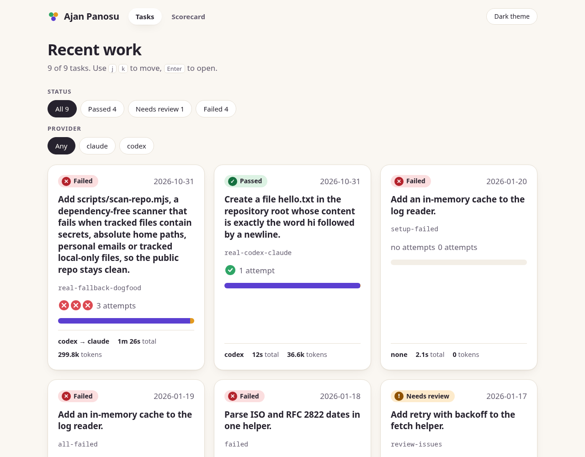
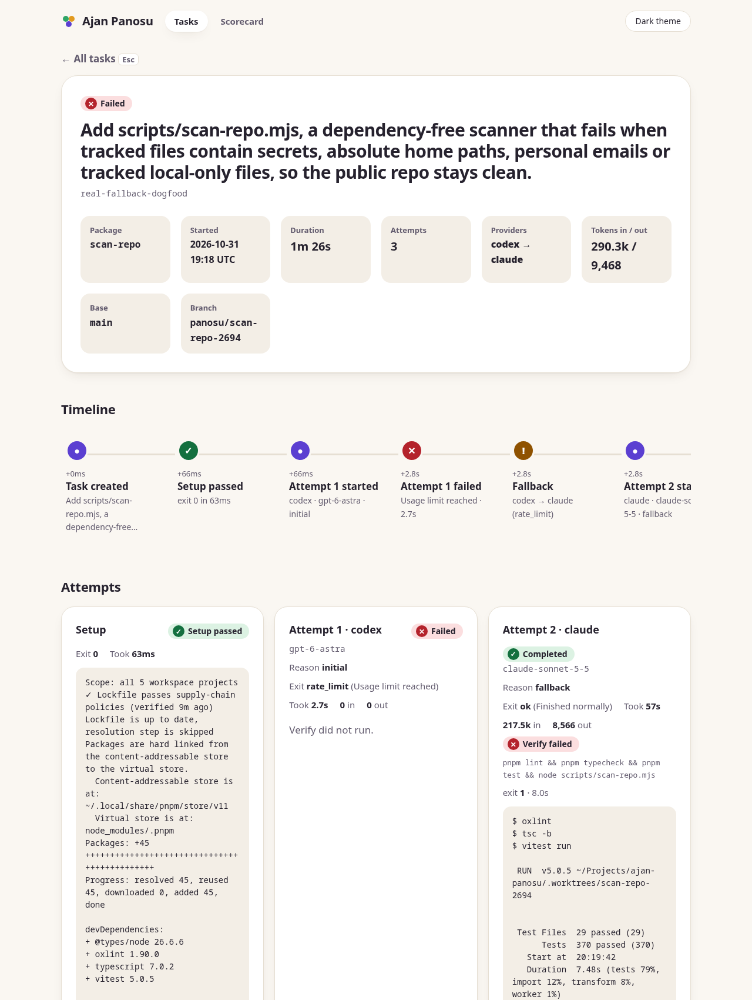
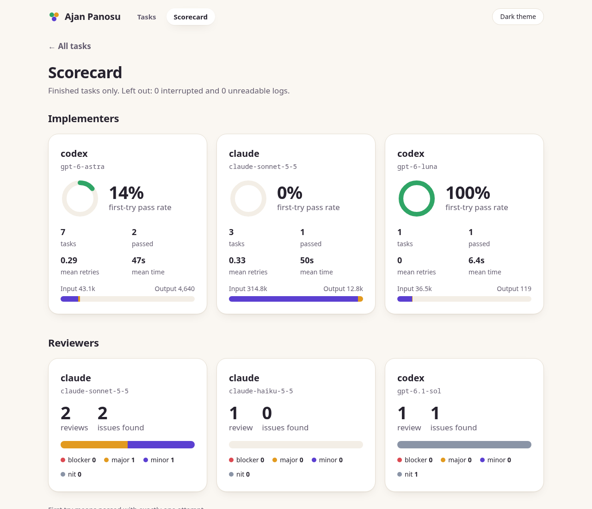

# Dugout

**Your coding agents' dugout.** One orchestrator hands coding tasks to Codex and Claude, checks the work with your own tests, has the other model review it, and keeps a privacy-safe log of everything that happened.

Dugout runs on the subscriptions you already have. It starts the official `claude` and `codex` CLIs as child processes: no API keys to hand over, no token extraction, no unofficial endpoints, no telemetry.



## Why

- **Quota is the scarce resource.** An expensive orchestrator doing all the typing burns a Pro limit fast. Dugout keeps the orchestrator thin: it writes a task package and reads a short verdict.
- **Limits happen.** When Codex hits its usage limit, Claude Sonnet takes over automatically (this was observed live, see `docs/contracts/provider-adapter.md`).
- **Trust, but verify.** Your `verify` command runs after every attempt, failures go back to the same model, and the other provider reviews the diff before you see it.
- **See what happened.** Every task leaves an event log; a local board shows attempts, retries, review verdicts, diffs and a per-model scorecard.

## How it works

```
orchestrator (Claude Opus)           writes a task package, reads a short verdict
        │  dugout delegate task.md
        ▼
 git worktree per task ── attempt loop ── Codex first, Claude Sonnet as fallback
        │                    │
        │                    └─ your verify command runs after every attempt;
        │                       failures are fed back, up to max_retries
        ▼
 cross-review by the other provider (structured JSON)
        ▼
 event log (JSONL, outside the repo)  →  read-only API  →  board
```

A task package is a Markdown file with YAML frontmatter: the goal, files to read, constraints, acceptance criteria and one `verify` command. See `docs/contracts/task-package.md` and `docs/orchestrator-guide.md`.

|   |   |
|---|---|
|  |  |

## Quick start

Requirements: Node 24+, pnpm, and the `claude` and/or `codex` CLIs logged in for real runs.

```
pnpm install
pnpm lint && pnpm typecheck && pnpm test && pnpm build

# the board on the bundled example logs, no model calls
pnpm demo

# the board on your own logs (~/.dugout/events), opens your browser
pnpm board

# try the whole flow without any model call
node packages/cli/dist/bin.js delegate task.md --scenario success --events-dir /tmp/dugout-events
node packages/cli/dist/bin.js list --events-dir /tmp/dugout-events
```

Real runs (`dugout delegate` without `--scenario`) spend subscription quota. Start with a tiny task and the default models. A step-by-step walkthrough (writing a task package, running it, reading the result, the board, using it from Claude Code) is in [`docs/getting-started.md`](docs/getting-started.md).

## Configuration

`~/.dugout/config.json` is optional. Everything has a default:

```json
{
  "models": {
    "codex":  { "implement": "gpt-6.1-sol", "review": "gpt-6.1-sol" },
    "claude": { "implement": "claude-sonnet-5-5", "review": "claude-sonnet-5-5" }
  },
  "verifyTimeoutMs": 600000,
  "claude": { "allowedTools": ["Write", "Edit", "Read"] }
}
```

For faster Claude runs you can opt in to letting the implementer run your project's own commands, for example `"allowedTools": ["Write", "Edit", "Read", "Bash(pnpm *)"]`. The Claude side has no sandbox, so this is off by default; see `SECURITY.md`.

## Status

Early but complete end to end: core with a scripted `fake` provider, the `dugout` CLI (`delegate`, `list`, `eval`), real Codex and Claude adapters, a read-only API with scorecard math, and the React board. More providers are planned. Details: `docs/architecture.md`, `docs/plans/`.

## Layout

| Path | What |
|---|---|
| `packages/core` | zod schemas, adapter interface, `runTask` (retry, fallback, verify, review), scorecard math. No I/O. |
| `packages/cli` | `dugout` command, worktrees, verify runner, event writer, Codex and Claude adapters, `eval`. |
| `packages/server` | read-only Hono API (`dugout-serve`). |
| `packages/web` | React + Vite board (task list, task detail with diff, scorecard). |
| `docs/` | PRD, architecture, contracts, ADRs, plans, design prototypes. |
| `fixtures/` | example event logs and sanitized real CLI samples. |
| `evals/` | golden tasks with hidden checks for comparing models. |

## Safety

- One git worktree per task; the CLI never merges anything.
- Event logs live in `~/.dugout/events`; the home directory is replaced by `~` before writing.
- The board and API never read `~/.claude` or `~/.codex`, and the API accepts only loopback `Host` headers.
- `node scripts/scan-repo.mjs` runs in CI to keep secrets and personal paths out of the repository.

## Contributing

Issues and small pull requests are welcome, see `CONTRIBUTING.md`. Security reports: `SECURITY.md`.

## License

MIT, see `LICENSE`.
